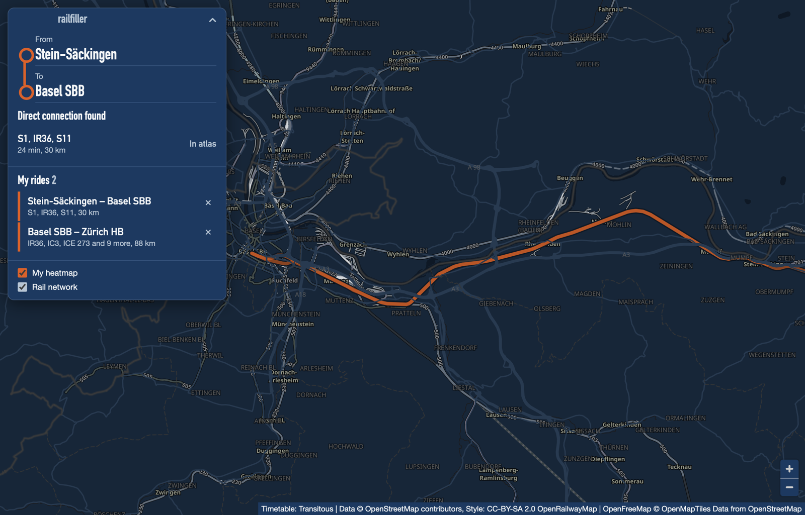
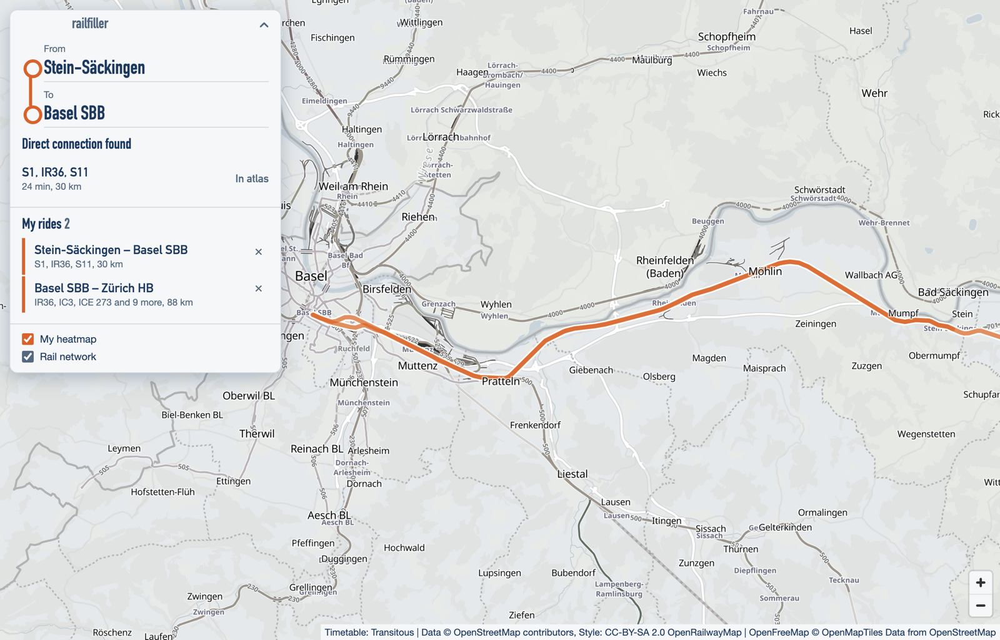

# railfiller

An exploration atlas for railway lines worldwide, built as an Electron app for Apple Silicon Macs. The rail network sits on the map in grey, and your own rides fill in orange.



## Features

- **Check a connection:** Pick a departure and an arrival station anywhere in the world. The app checks the next 7 days of the timetable for trains without a transfer, and you can add what it finds to your atlas.
- **Tap a line:** From zoom level 9, tap a rail line to add the stretch between two stops.
- **Switch layers:** Show or hide your heatmap and the rail network. Stretches covered by several saved rides glow stronger.
- **Collapse the menu:** Fold the panel away to see more of the map.
- **Light and dark:** The app follows your macOS appearance setting.

Your rides stay on your Mac, in a SQLite database in `~/Library/Application Support/railfiller/`.



## Limits

- A "direct connection" means the timetable data shows a train without a transfer. The data has gaps, so a "no" doesn't prove that no such train exists.
- Tapping only finds lines with scheduled trains on a weekday morning. Closed lines, heritage railways and very rare trains won't appear.
- Some regions have no track shapes. Those routes connect the stops directly and are drawn dashed, marked as "estimated route".

## Build it yourself

You need an Apple Silicon Mac. The app is developed with Node.js 25.

```sh
npm install
npm run dev        # run the app with hot reload
npm test           # run the logic tests
npm run typecheck
npm run dist       # build dist/railfiller-*-arm64.dmg
```

The DMG is ad-hoc signed and not notarized, so macOS shows a warning when you open it on another Mac.

## Data sources

| Source | Used for |
|---|---|
| [Transitous](https://transitous.org/api/) ([data sources](https://transitous.org/sources/)) | Stations, direct connections and route shapes |
| [OpenRailwayMap](https://wiki.openstreetmap.org/wiki/OpenRailwayMap/API) | Rail network on the map |
| [OpenFreeMap](https://openfreemap.org/) | Base map |
| [OpenStreetMap](https://www.openstreetmap.org/copyright) | Underlying map data |

These are free community services. Transitous and OpenRailwayMap don't allow commercial use, so check their terms before you build on this project.

## License

The code is available under the [MIT License](LICENSE). Map data and map styles keep their own licenses, which the app credits on the map.
